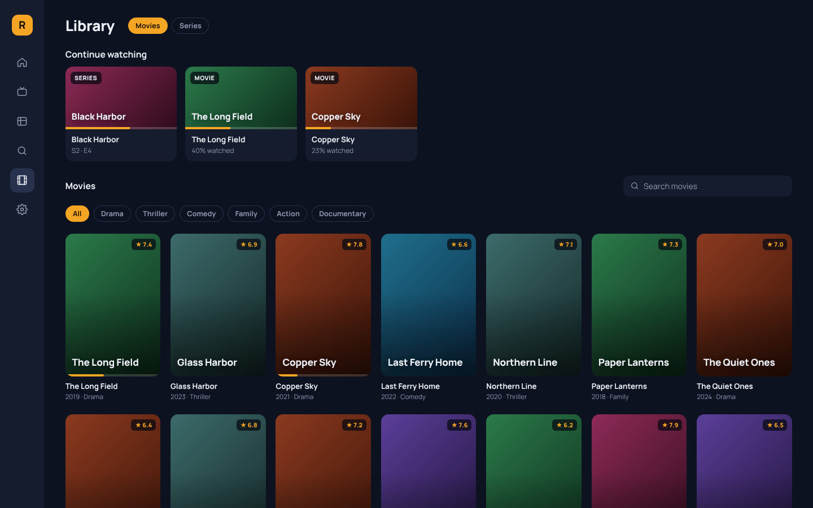

# Radiate

A fast, calm, open source player for live TV, guides and on-demand
libraries from the sources you already have. For Windows, macOS and Linux.

Radiate is the watching companion to
[Resonate](https://github.com/livexibot/Resonate): Resonate for listening,
Radiate for watching.

**[Download Radiate](https://github.com/livexibot/Radiate/releases/latest)**:
an installer for Windows (`.exe` or `.msi`), a `.dmg` for macOS, and an
AppImage, `.deb` or `.rpm` for Linux. Radiate updates itself after that.

## What it does

- **Live sports first.** Home opens on the matches on now and the ones
  starting soon, from your favorites and every sports group. Live and the
  guide have a Sports view, and you choose which groups count as sports.
- **Watch with reactors.** Save YouTube reactors by link, then show up to
  four at once, each in a box beside the match: drag them anywhere, resize
  them to any shape by their corners and edges, and the match makes room.
  Each box has its own volume and mute, opens where you left it, and stays
  on top of everything else. If the reactors are behind your feed, delay
  the match a few seconds to line them up: it goes back through what has
  already loaded instead of pausing. It's YouTube's own player; a video
  that doesn't allow other apps opens on youtube.com in its own window
  instead.
- **Live TV that doesn't buffer.** A channel opens 10 s behind live, so a
  slow moment at the provider never stops the picture. The progress bar
  keeps the picture in the middle, shows the buffer built up ahead of it
  and how many seconds behind live you are. Drag back to see a goal
  again, up to the last 5 minutes, then forward or straight back to live.
- **Your sources.** M3U and M3U8 playlists by link or file, Xtream Codes
  logins (live TV, movies and series), and XMLTV guides, gzipped or not.
  Or try it with free public channels by country.
- **A real TV guide.** A grid with a now-line and group filters. Nothing
  plays until you open a channel, so browsing never uses one of your
  provider's connections. Channels are matched to the guide by id, by name and by a fuzzy
  score, and "Fix guide" lets you pick the match yourself; it's remembered.
- **Picture fast.** Playlists of tens of thousands of channels are indexed
  locally in about a second, so lists and the guide never wait for the
  network. Radiate opens on the channel you watched last.
- **Zapping like a TV.** Up and down to change channel, type a number,
  Back twice for the previous channel, Enter for the channel list.
- **Movies and series** from Xtream sources in one Library, grouped into
  seasons, with progress, resume and Continue watching.
- **Multiview.** Up to four channels at once, one big and three small or a
  2×2 grid, with sound following the highlighted tile. It never opens more
  streams than your provider allows.
- **Honest errors.** When a stream fails, Radiate says why in plain words
  (offline at the provider, account refused, server trouble) and offers to
  try again.
- **Keeps itself up to date.** Radiate checks for a new version in the
  background, verifies its signature, and installs it when you say so.
- **Yours.** No ads, no telemetry, no account. Passwords stay in your
  system's keychain. Export and import every setting as one file.

| Home | Player |
| --- | --- |
|  |  |
| **Multiview** | **Library** |
|  |  |

## How it works

Radiate is a Tauri app. A Rust core parses playlists and guides as they
download and keeps them in a local SQLite index. The interface is a web
page inside the app's window. Streams go through a small relay inside
Radiate, on your computer only, which is also where your provider's
connection limit is kept. Formats the built-in player can't decode (MKV
files, AC-3 or MP2 sound, HEVC or MPEG-2 pictures) are converted on the fly
by a copy of [FFmpeg](https://ffmpeg.org) that Radiate installs next to
itself (GPLv3, see [its notice](apps/desktop/src-tauri/licenses/FFMPEG.txt)),
on the same connection, so they play inside the app.

Reactors are YouTube's official embedded player, loaded only when you add
or show one. Radiate never downloads or records YouTube's video.

Radiate ships no channels and doesn't point to any. It plays what you
already have the right to watch.

## More

- [Helping with Radiate](CONTRIBUTING.md)
- [Developing Radiate](docs/development.md)
- [How the parts fit together](docs/contract.md)

Radiate is open source under the [MIT licence](LICENSE).
