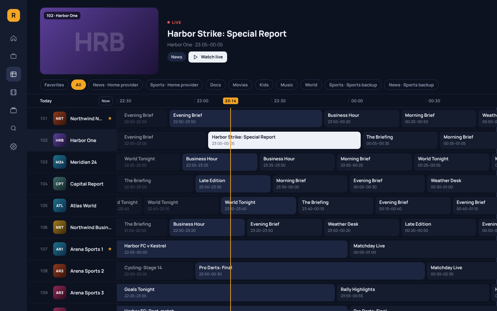
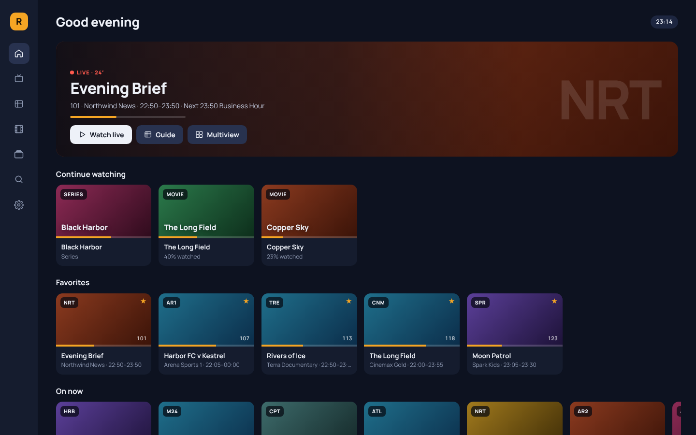
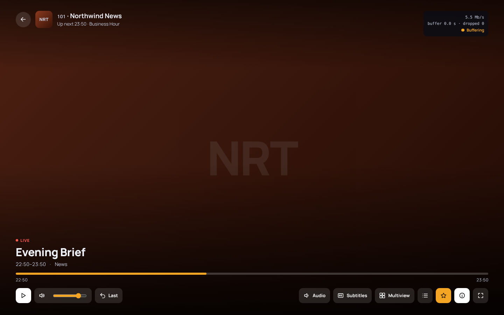
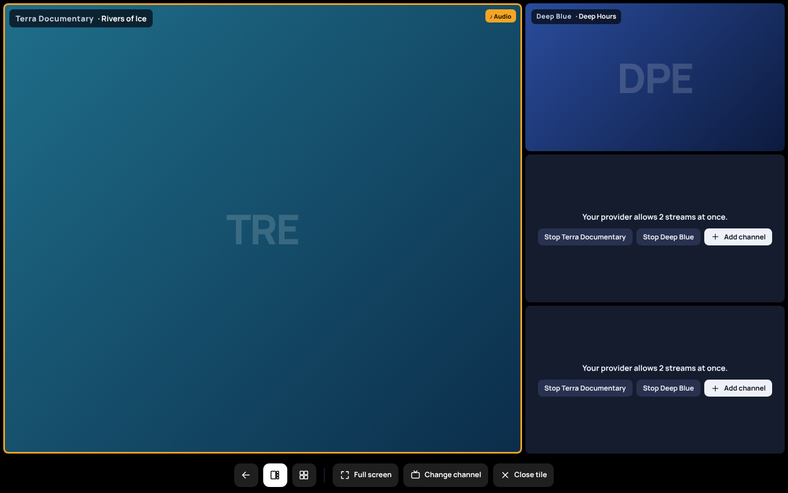
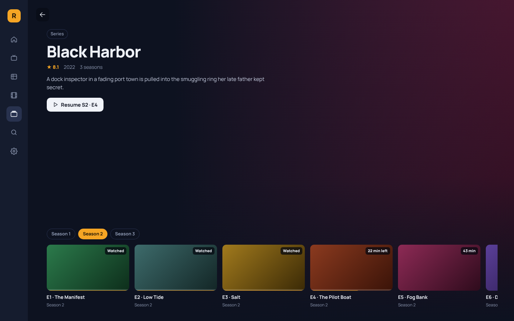

# Radiate

A fast, calm, open source player for live TV, guides and on-demand
libraries from the sources you already have. For Windows, macOS and Linux.

Radiate is the watching companion to
[Resonate](https://github.com/livexibot/Resonate): Resonate for listening,
Radiate for watching.

**[Download Radiate](https://github.com/livexibot/Radiate/releases/latest)**

## What it does

- **Your sources.** M3U and M3U8 playlists by link or file, Xtream Codes
  logins (live TV, movies and series), and XMLTV guides, gzipped or not.
  Or try it with free public channels by country.
- **A real TV guide.** A grid with a live preview, a now-line and group
  filters. Channels are matched to the guide by id, by name and by a fuzzy
  score, and "Fix guide" lets you pick the match yourself; it's remembered.
- **Picture fast.** Playlists of tens of thousands of channels are indexed
  locally in about a second, so lists and the guide never wait for the
  network. Radiate opens on the channel you watched last.
- **Zapping like a TV.** Up and down to change channel, type a number,
  Back twice for the previous channel, Enter for the channel list.
- **Movies and series** from Xtream sources, grouped into seasons, with
  progress and resume.
- **Multiview.** Up to four channels at once, one big and three small or a
  2×2 grid, with sound following the highlighted tile. It never opens more
  streams than your provider allows.
- **Honest errors.** When a stream fails, Radiate says why in plain words
  (offline at the provider, account refused, server trouble) and offers to
  try again.
- **Yours.** No ads, no telemetry, no account. Passwords stay in your
  system's keychain. Export and import every setting as one file.

| Home | Player |
| --- | --- |
|  |  |
| **Multiview** | **Series** |
|  |  |

## How it works

Radiate is a Tauri app. A Rust core parses playlists and guides as they
download and keeps them in a local SQLite index. The interface is a web
page inside the app's window. Streams go through a small relay inside
Radiate, on your computer only, which is also where your provider's
connection limit is kept. Formats the built-in player can't handle open in
[mpv](https://mpv.io) when it's installed.

Radiate ships no channels and doesn't point to any. It plays what you
already have the right to watch.

## More

- [Helping with Radiate](CONTRIBUTING.md)
- [Developing Radiate](docs/development.md)
- [How the parts fit together](docs/contract.md)

Radiate is open source under the [MIT licence](LICENSE).
